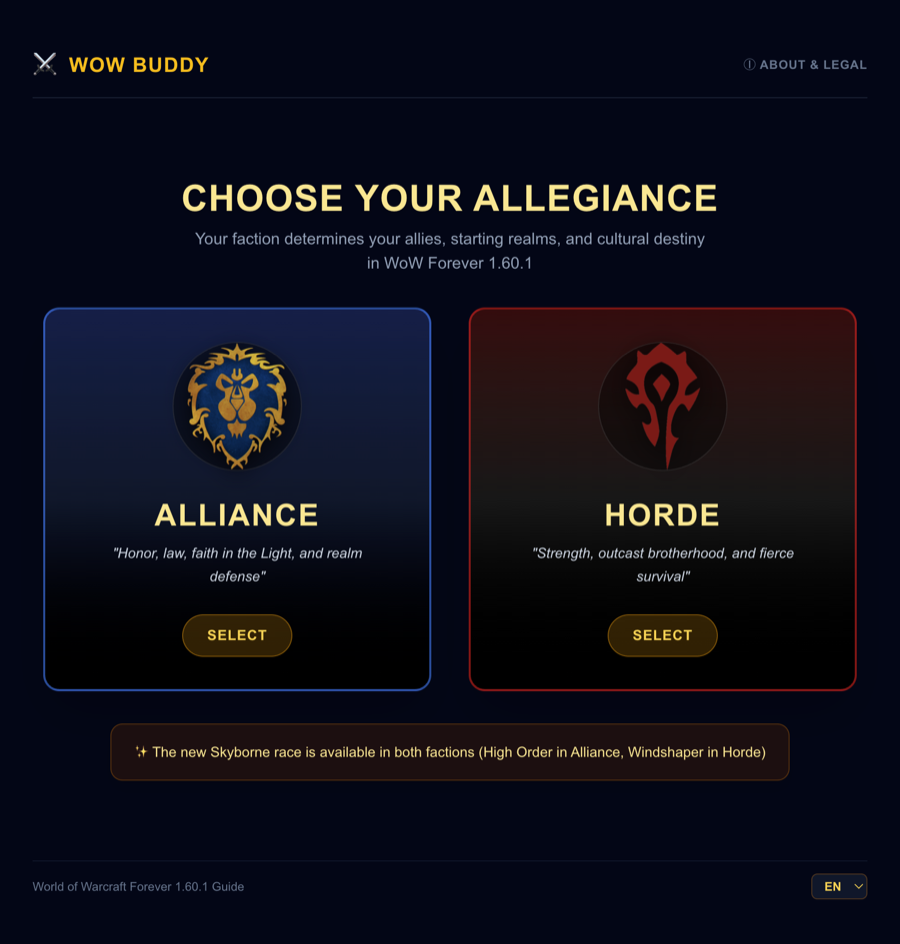
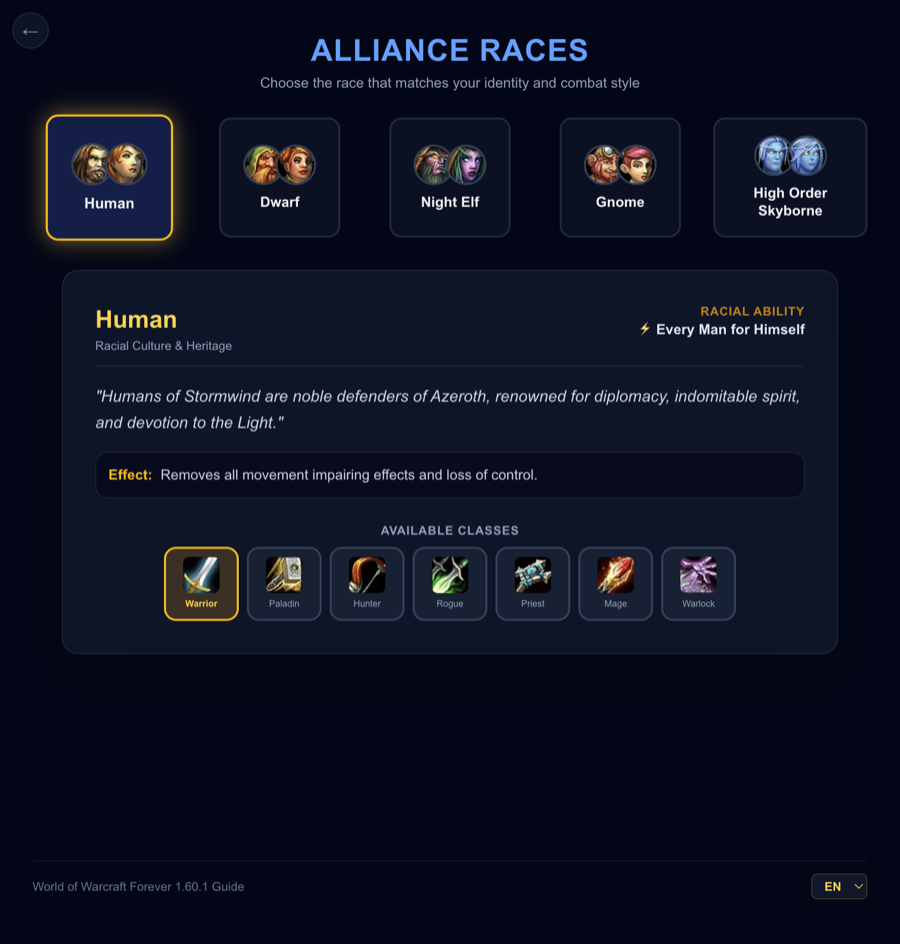
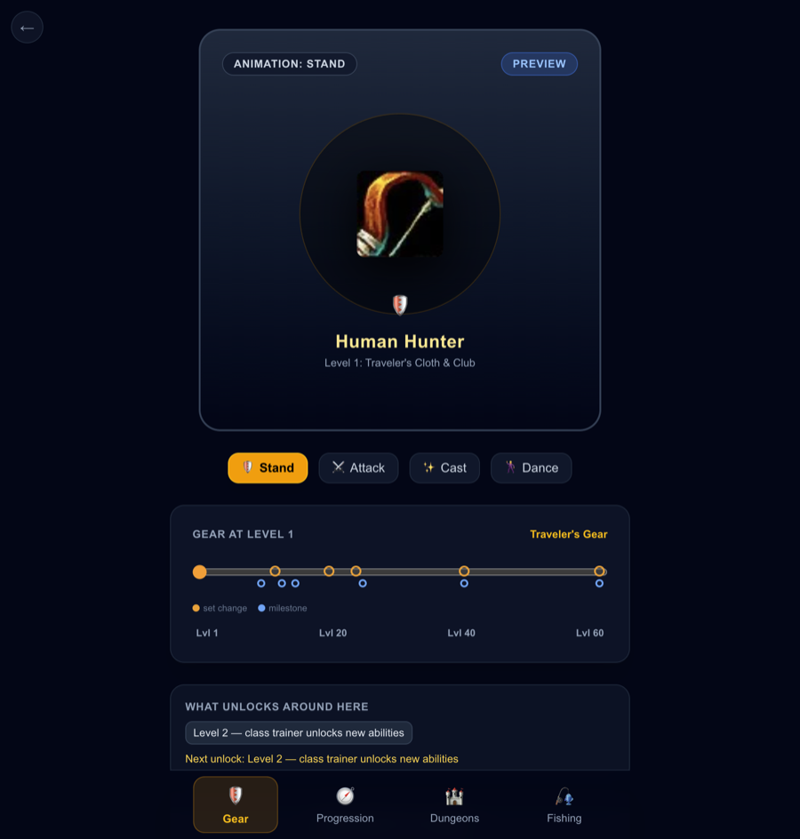
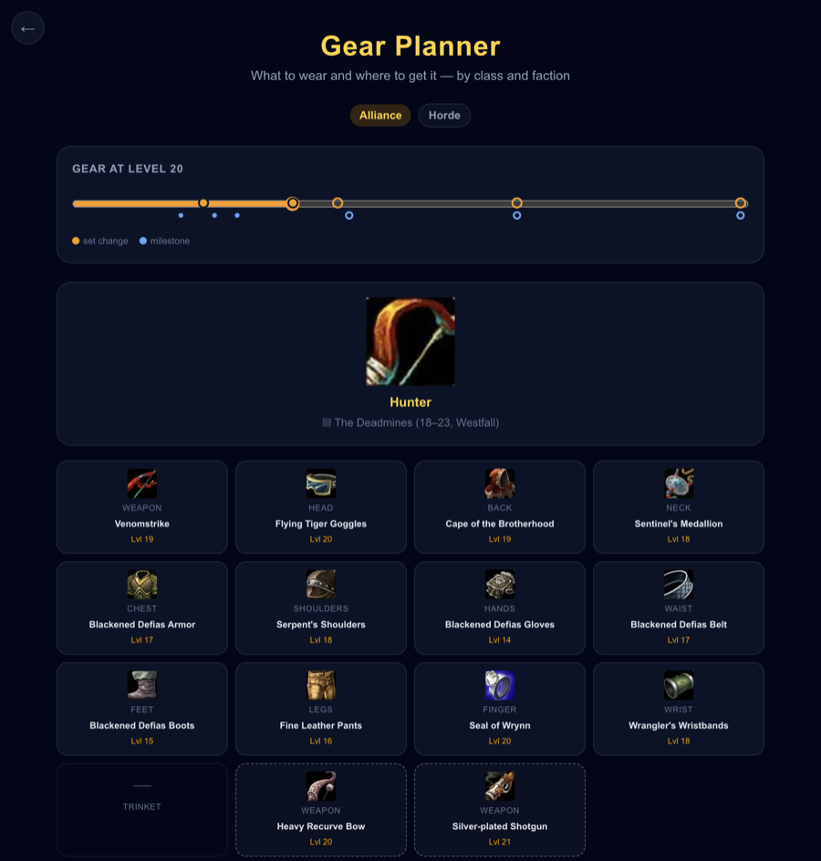
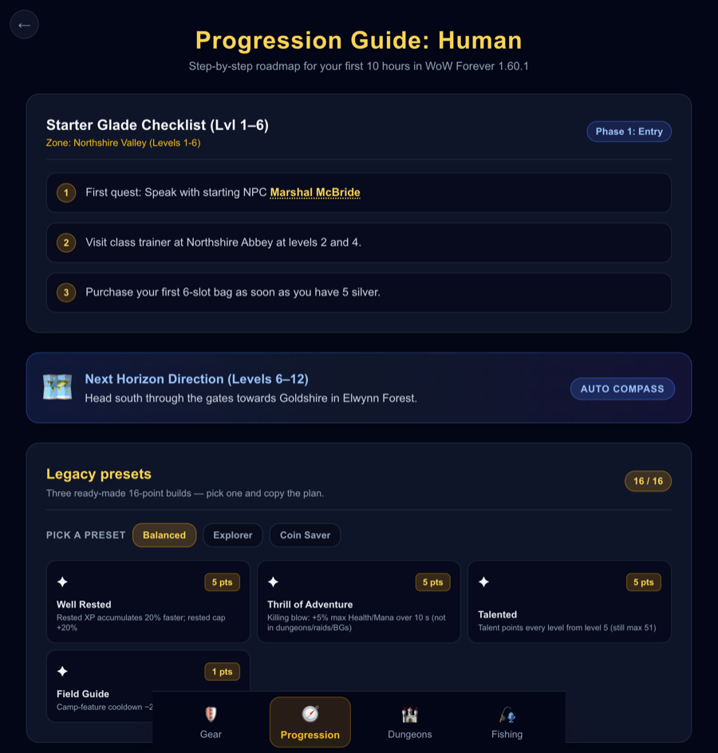
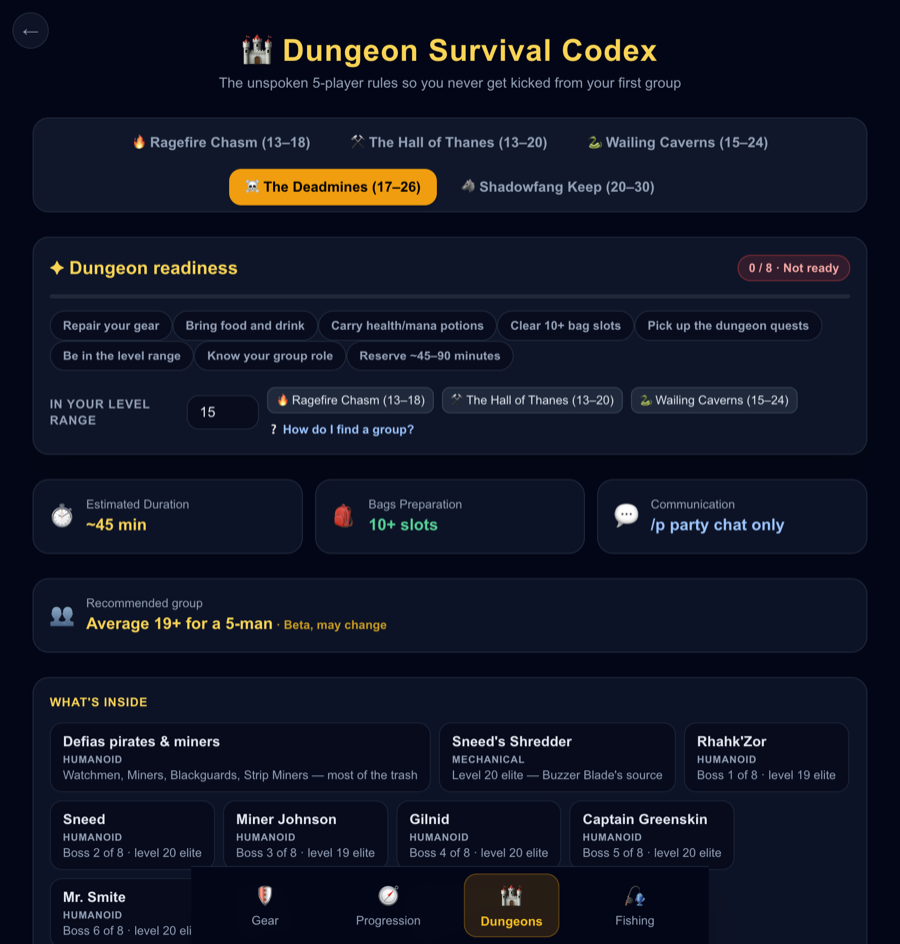
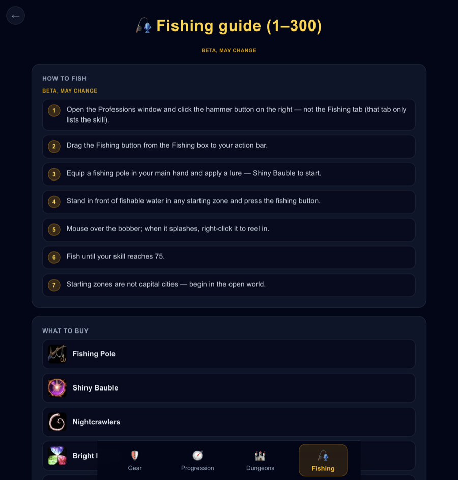
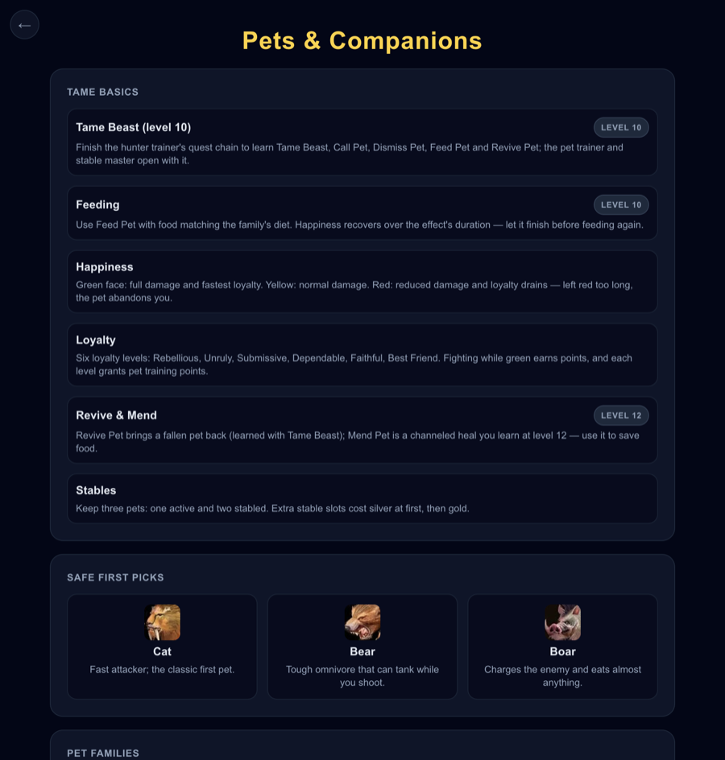
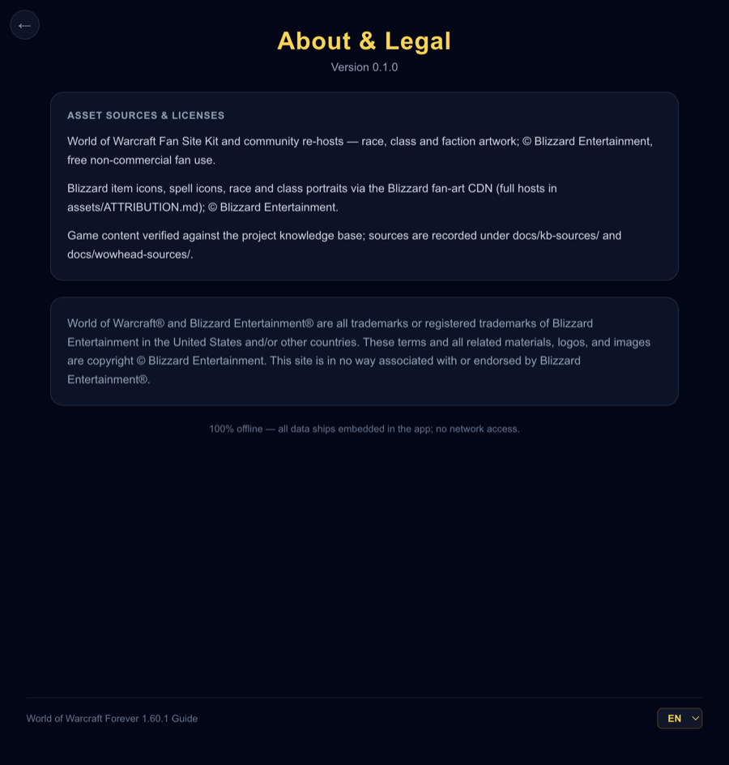

# WoW Buddy

> A pocket companion for **World of Warcraft: Forever 1.60.1** — offline, source-traced, and trilingual.



**WoW Buddy** is a desktop and web guide for the first ten hours of WoW Forever. It answers the
questions a new or returning player actually has — *which race and class? what should I wear at this
level? where do I go next? what do I bring to my first dungeon? how do I train fishing? which pet
should I tame?* — without sending you into a wiki rabbit hole mid-session.

It ships as one self-contained app: all content and artwork are embedded, there is no account, no
backend, and no runtime network access. It is also deliberately conservative about what it claims:
WoW Forever is a moving beta, so the app distinguishes what is verified from what is still likely to
change.

> Unofficial fan project. Not affiliated with or endorsed by Blizzard Entertainment.
> Game artwork © Blizzard Entertainment — see [`assets/ATTRIBUTION.md`](assets/ATTRIBUTION.md).

## A quick tour

|  |  |
|:--:|:--:|
|  |  |
| **Race & class selection.** Five races per faction with lore, racial ability, and available classes; clicking a class confirms and continues. | **Character viewer.** An honest `Preview` badge, a 1–60 gear-evolution slider with set/milestone dots, starter spells with unlock levels, and glossary popovers. |
|  |  |
| **Gear planner.** All nine classes × both factions: weapon and armor slots for the 1–6, 12–16, 20–24, and 24–30 bands, each with its source. | **Progression guide.** Starter-zone checklist (1–6), next-horizon compass (6–12), three 16-point Legacy presets, the fishing card, and comfort tips. |
|  |  |
| **Dungeon codex.** Five dungeons with ForeverDB ranges, a readiness meter, group-finding help, boss/loot/prep/watch-out sections, and loot etiquette. | **Fishing guide.** The full 1–300 route: trainer tables by faction, shop list, four skill tiers, and Nat Pagle's artisan quest. |
|  |  |
| **Pets & companions.** Hunter tame basics, 17 family cards, safe first picks, and notable pets by level — plus warlock minions. | **About & legal.** Version, asset licenses, source folders, the offline statement, and Blizzard's required disclaimer. |

The app is fully usable in **English, Русский, and Suomi**. Proper nouns stay in English in every
locale, and the language choice is remembered on the device.

*Screenshots: release web build, English UI, Human Hunter, 900 px viewport.*

## Tech stack

| Layer | What it uses |
| --- | --- |
| Language | Rust 2021 |
| UI | [Dioxus 0.7](https://dioxuslabs.com/) (RSX components, router, document); native desktop via WebView and web via WebAssembly |
| Styling | Tailwind CSS v4, precompiled to `assets/app.css` — no runtime CSS build |
| Data | `serde` + `serde_json`; content JSON is compiled in with `include_str!` |
| Assets | 195 Blizzard icons and art pieces embedded at compile time as `data:` URIs through `assets/manifest.json` and `tools/assets/generate.mjs` |
| Platform glue | `arboard` (native clipboard), `web-sys` + `wasm-bindgen-futures` (browser) |
| Build | Cargo, plus the Dioxus CLI (`dx`) for web/mobile bundles |
| Tests | `cargo test` — 46 test binaries covering content, provenance, coverage, i18n, assets, and navigation |

Beyond these, there is no database, HTTP client, state library, or runtime asset loader.

## Grounding: how a fact gets into the app

WoW Forever differs from Classic Era in ways that matter — dungeon levels, loot stats, XP rules, and
quality-of-life changes. Old classic guides are often simply wrong for it. The project therefore
treats **provenance as part of the product**, not as a footnote.

**The pipeline:**

1. Gather the claim from the project's NotebookLM knowledge base, the game client, or an established
   reference.
2. Cross-check it wherever possible — Wowhead Forever, ForeverDB (client-datamined item/NPC/dungeon
   pages), and profession references.
3. Save the raw evidence in the repository under
   [`docs/kb-sources/`](docs/kb-sources/), [`docs/wowhead-sources/`](docs/wowhead-sources/),
   [`docs/foreverdb-sources/`](docs/foreverdb-sources/), or
   [`docs/wow-professions-sources/`](docs/wow-professions-sources/).
4. Author the shipped JSON with pointers back to that evidence. Every dungeon, for example, carries
   `kb`, `wowhead`, and `foreverdb` source paths.
5. When sources disagree, record the conflict and take the more current client-verified value
   (ForeverDB dungeon ranges override the classic ones). When nothing confirms a claim, mark it
   `verified: false` and let the UI print **“Beta, may change.”**

A test can check that a fact has a source — it cannot check that the source is telling the truth.
That is why the raw answer sits next to the claim, so a reviewer can diff the shipped text against
the text it came from.

**What this looks like in practice:**

- Dungeon ranges follow ForeverDB, not Classic Era (e.g. Deadmines 17–26, Shadowfang Keep 20–30).
- Beta-only calls are labelled even when they come from a source: the recommended average group
  level is always shown with the Beta marker.
- Content that is still awaiting player confirmation — such as some new Deadmines items — is called
  out in the relevant “Watch out” section instead of being presented as settled.
- The fishing guide notes that the current beta has no Apprentice-level requirement, while older
  sources say level 5.
- The character viewer says `Preview` and shows class art. It will not say “3D” until a real,
  verified model ships.

### Asset policy

All 195 icons and art pieces are embedded at compile time; nothing is hotlinked or fetched at
runtime. `assets/manifest.json` records a source and license for every asset, and
[`assets/ATTRIBUTION.md`](assets/ATTRIBUTION.md) carries the Blizzard Fan Site Kit disclaimer.
`tests/asset_urls_test.rs` fails if `wowhead.com` or `zamimg.com` URLs appear in `src/`.
The app is a free, non-commercial fan guide; Blizzard may revoke fan use at any time, and assets can
be swapped through the manifest without code changes.

## Project layout

```text
src/
  views/        screen-level UI (faction, race, dressing room, gear, progression, dungeons, fishing, pets)
  components/   reusable UI (bottom nav, sliders, readiness card, popovers, footer)
  models/       embedded datasets and domain logic
  assets/       asset registry and generated data-URI table
  i18n/         EN / RU / FI dictionaries
assets/
  data/*.json   game content (gear, dungeons, fishing, pets, legacy, comfort tips…)
  i18n/*.json   UI strings in three locales
  manifest.json asset provenance and source paths
  ATTRIBUTION.md
docs/
  kb-sources/                 project-KB answers per topic
  wowhead-sources/            Wowhead Forever checks
  foreverdb-sources/          ForeverDB item/NPC/dungeon pulls
  wow-professions-sources/    profession references
  screenshots/                README screenshots
tests/                         content, provenance, coverage, i18n, and asset gates
tools/assets/generate.mjs      manifest → src/assets/generated.rs
```

## Running the app

**Prerequisites:** a stable Rust toolchain. For the browser and mobile targets, install the Dioxus
CLI once:

```bash
cargo install dioxus-cli --locked
dx --version
```

```bash
# Native desktop window
cargo run

# Browser preview with hot reload (http://localhost:8080)
dx serve --platform web

# Release web build
dx build --platform web --release
# Serve target/dx/wow-buddy/release/web/public with any static file server.

# Full test suite
cargo test

# Regenerate embedded assets after editing assets/manifest.json
node tools/assets/generate.mjs
```

Platform-specific prerequisites (Linux WebKitGTK, iOS, Android) and the maintained manual test
checklist live in [`DEV_GUIDE.md`](DEV_GUIDE.md).

## Status

Version `0.1.0` targets the current WoW Forever 1.60.1 beta.

- **Gear coverage:** 9 classes × both factions for the 1–6, 12–16, 20–24, and 24–30 bands. The
  30–60 sync is planned; until it lands, the app does not pretend to have it.
- **Content:** five dungeons, the full fishing route, 17 pet families, and warlock minions ship with
  provenance. A small number of newer items await player confirmation and are labelled accordingly.
- **Hero models:** pre-rendered 3D models and animation playback are parked until a verified model
  export exists. The viewer deliberately stays on paper-doll class art and says `Preview`.
- **Localization:** RU and FI are complete drafts awaiting native proofreading; the English source and
  proper nouns are the reference.
- **Packaging:** the web release is the tested bundle. A packaged Windows executable has not been
  produced yet.

## Fan-use notice

This is a personal, non-commercial fan project. It is not affiliated with, endorsed by, or
sponsored by Blizzard Entertainment. World of Warcraft and Blizzard Entertainment are trademarks or
registered trademarks of Blizzard Entertainment in the United States and/or other countries. All
game artwork and related materials are copyright © Blizzard Entertainment. See
[`assets/ATTRIBUTION.md`](assets/ATTRIBUTION.md) for per-source details and the full disclaimer.
